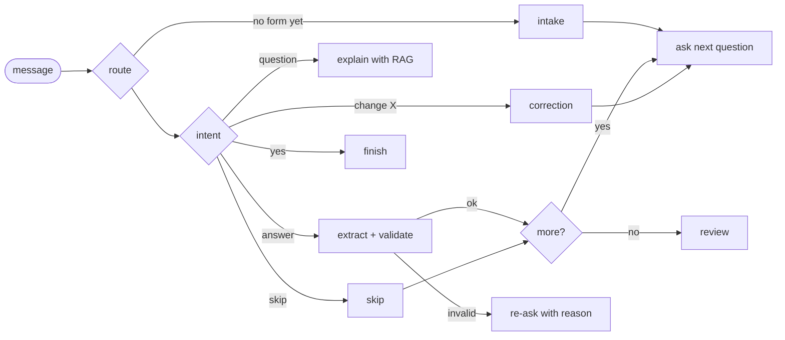

# Form Saathi

A chat assistant that helps people fill Indian bank and government forms in Tamil, Hindi, Odia or English.

## Why I built this

My father isn't comfortable reading English and my mother's eyesight is weak. Every time they need to fill a bank slip, a KYC form or an electricity connection form, someone has to sit with them, or they pay an agent near the office. I wanted something that asks them one question at a time in their own language, explains words like "sanctioned load" or "encumbrance", catches mistakes before they reach the counter, and can work entirely by voice.

## What it does

- You pick a language and a form, then answer questions by typing, tapping or speaking.
- A copy of the form on the right side fills in as you answer.
- Wrong inputs are caught immediately: invalid Aadhaar (Verhoeff checksum), PAN, IFSC, GSTIN (checksum), PIN, mobile number, impossible dates, a cheque older than 3 months, and so on.
- Ask "what does this mean?" on any question, and it answers from the department's rules (RAG) and shows where the answer came from.
- At the end you get a summary, warnings (for example, "deposit is more than 3 months' rent"), a checklist of documents to carry, and a PDF to copy from.
- For a form that isn't built in, you upload a photo of it and the vision model turns it into questions.
- Accessibility options: larger text, high-contrast colours, read-aloud, and a fully hands-free mode that reads each question, listens, and repeats the answer back.
- It works on phones and can be installed to the home screen like an app (PWA).

There are 16 forms right now: bank KYC, cash withdrawal, savings account, cheque, GST PMT-06 challan, ITR-1, EPF Form 11, job application, electricity (domestic and commercial), LPG, Metro water, property tax, registration deed, rental agreement and commercial vehicle permit.

## How it works

The backend is a LangGraph state graph. Each user message runs through it once, and a checkpointer keeps the session state between messages.



Some decisions and why I made them:

- **Validation is plain code, not the LLM.** A model can say a wrong Aadhaar number looks fine. Checksums can't. The LLM is only used where rules are weak: understanding free-text answers, transliterating names typed in Tamil, translating form-specific text, and writing explanations.
- **Every LLM call has a fallback.** If the Groq call fails, the graph still works with rules, and form-specific text stays in English. This also means the tests run offline.
- **Forms are JSON, not code.** Adding a form means writing one file in `backend/app/forms/schemas/`. Common fields such as name, mobile and Aadhaar come from a shared file that is already translated into all four languages.
- **BM25 instead of embeddings for RAG.** The knowledge notes are short and full of exact terms (PMT-06, OVD, 80C), where keyword search works well and needs no embedding model. The index is wrapped as a LangChain retriever, so it can be swapped for a vector store later.
- **Sensitive numbers are masked.** Aadhaar, PAN and account numbers only show the last 4 digits in the UI and in read-back. Sessions are in memory only and expire after 30 minutes.

Stack: Python, FastAPI, LangGraph, LangChain, Groq (Llama 3.3 70B for text, Llama 4 Scout for images), ReportLab for PDFs, and React with TypeScript and Vite for the frontend. Voice uses the browser's speech recognition and speech synthesis.

## Running it

Backend:

```bash
cd backend
python -m venv .venv && source .venv/bin/activate
pip install -r requirements.txt
cp .env.example .env        # add a Groq API key (free at console.groq.com)
uvicorn app.main:app --reload --port 8000
```

Frontend:

```bash
cd frontend
npm install
npm run dev                 # http://localhost:5173
```

Tests (no API key needed):

```bash
cd backend
python -m pytest -q
```

To put it online (Render for the backend, Vercel for the frontend) and install it on a phone, see [DEPLOY.md](DEPLOY.md).

## Measuring it

```bash
cd backend
python -m eval.run_eval        # accuracy on labelled test sets, rules-only vs rules + LLM
python -m eval.usage_report    # anonymous usage numbers collected while people use the app
```

The evaluation covers intent routing, value extraction (including rejecting invalid values) and RAG retrieval, in all four languages, and writes `backend/eval/results/EVAL.md`. While people use the app it records only counts (time per form, invalid inputs caught, typed/tapped/spoken), never their answers. [TESTING.md](TESTING.md) has the manual test plan and a made-up test identity to use instead of real details.

The first evaluation run found a real bug: Hindi "हाँ" (yes) wasn't recognised, because splitting words with `\w` breaks Devanagari at vowel signs. A tester also found that "14.2 கிலோ டொமஸ்டிக்" (English words in Tamil script) didn't pick the 14.2 kg option. Both are fixed, with tests.

The backend asks Groq which models your API key can use and falls back automatically if the configured one isn't available. `/api/health` shows which model is in use.

## Fine-tuning (in progress)

`finetune/` has a pipeline to fine-tune Qwen2.5-1.5B with QLoRA. The goal is a model that rewrites official form language into plain Tamil, Hindi, Odia and English.

- `build_dataset.py` builds jargon-to-plain pairs. There are 50 hand-written seed pairs, and the rest are generated from the sentences in the forms and the knowledge notes.
- `train_qlora.ipynb` trains on Colab.
- `serve_simplifier.py` serves the trained model.
- `eval_simplifier.py` compares it with the base model using chrF, the share of answers still containing jargon, and whether the answer is in the right script.

## Status and what's next

- [ ] Run `eval.run_eval` with Groq and add the results table here
- [ ] Run the user study in TESTING.md and add the results
- [ ] Run the fine-tuning and add the evaluation results here
- [ ] Test the photo reader on real forms and measure how many fields it gets right
- [ ] Replace the built-in forms with field lists taken from the official forms (current ones are based on what these forms usually ask)
- [ ] Get the Tamil, Hindi and Odia text reviewed by native speakers
- [ ] Verify the rule notes in `backend/app/rag/knowledge/` against official sources; rates like stamp duty change

The PDF it generates is a draft to copy from. It is not the official form.

## Project structure

```
backend/app/
  agents/       graph.py, nodes.py, vision.py
  forms/        engine.py, common_fields.json, schemas/
  rag/          retriever.py, knowledge/
  pdf/          generator.py
  validators.py, i18n.py, llm.py, service.py, main.py
backend/tests/
frontend/src/
finetune/
```
